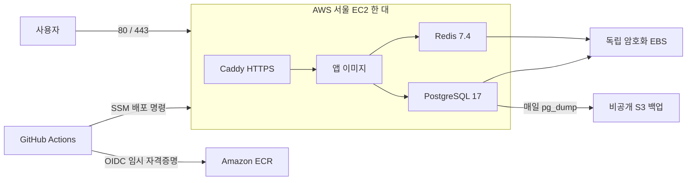

# WEBTER AWS 단일 EC2 구성

## 구현 범위

사용자가 지정한 EC2 한 대 + 앱·PostgreSQL·Redis Docker Compose + GitHub Actions 이미지 배포를 Terraform으로 구성한다. 실제 리소스 생성이나 배포는 아직 실행하지 않았다. 앱 프레임워크·앱 Dockerfile·업무 API는 포함하지 않는다.



- Terraform: VPC·퍼블릭 서브넷·인터넷 게이트웨이·보안 그룹·EC2·EIP·EBS·ECR·IAM/OIDC·SSM 문서·백업 버킷을 관리한다.
- Docker Compose: 앱·DB·Redis·Caddy의 실행과 연결을 관리한다. Caddy는 같은 EC2의 HTTPS 프록시이며 별도 서버가 아니다.
- GitHub Actions: 앱 이미지를 `linux/amd64`로 빌드해 ECR에 등록하고 digest로 배포한다. AWS 키·SSH 키를 GitHub에 저장하지 않는다.
- 외부에는 80/443만 연다. SSH·PostgreSQL·Redis는 외부에 공개하지 않는다. 호스트의 앱 포트는 `127.0.0.1`에서만 준비 상태 점검에 사용한다.
- PostgreSQL·Redis·TLS·런타임 설정은 독립 EBS에 보관한다. EC2와 루트 디스크를 교체해도 같은 AZ의 데이터 EBS를 재사용한다. 데이터 볼륨 분리 전에 인스턴스를 정지하도록 설정한다. 재부팅 시 Docker 자체도 데이터 볼륨 마운트 이후에 시작하도록 제한한다.
- 앱 DB 계정은 `webter_app`이며 관리자·DDL 권한을 주지 않는다. 앱은 EC2 역할 자격증명을 IMDS로 받지 않는다.

## 적용 전 필요한 값

1. AWS 계정·로컬 AWS CLI 인증 및 리소스 생성 권한.
2. 앱의 Dockerfile·빌드 경로·컨테이너 포트·준비 상태 경로. 앱은 `0.0.0.0`에 수신하고 해당 경로에서 2xx를 반환해야 한다.
3. 운영 도메인. `domain_name`을 설정하고 A 레코드를 EIP로 연결한다. 도메인이 없으면 HTTP/IP 점검만 가능하며 구글 로그인·공개 운영 준비가 끝난 상태가 아니다.
4. GitHub 저장소가 `p1001q/WEBTER`, 배포 브랜치가 `main`인지 확인한다.

앱은 Compose가 제공하는 `DB_HOST`, `DB_PORT`, `DB_NAME`, `DB_USER`, `DB_PASSWORD`, `REDIS_HOST`, `REDIS_PORT`, `REDIS_PASSWORD`를 사용해야 한다. 프레임워크가 URL 형식을 요구하면 앱의 환경 설정 계층에서 변환한다. 앱의 자동 스키마 생성은 사용하지 않고 별도 관리자 마이그레이션을 설계한다.

## Terraform 준비와 검토

Terraform 1.10 이상 2.0 미만을 사용한다. 검증에 사용한 CLI는 1.14.9이며 AWS provider의 실제 선택은 `.terraform.lock.hcl`에 고정한다.

```sh
cd IN/terraform
cp terraform.tfvars.example terraform.tfvars
# terraform.tfvars에서 앱 포트·도메인·인스턴스 크기 등을 맞춘다.
terraform init
terraform fmt -check -recursive
terraform validate
terraform test
terraform plan -out=review.tfplan
```

`terraform test`는 mock AWS provider로만 실행하며 실제 AWS 리소스를 생성하지 않는다. 반면 `terraform plan`은 AWS를 조회한다. 검토한 계획을 실제 생성할 때만 `terraform apply review.tfplan`을 실행한다.

이 초안은 로컬 state로 시작한다. state·계획 파일·tfvars는 Git에서 제외한다. 운영 적용 전에 state의 보관·접근·복구 위치를 정하고, 팀에서 공유하면 암호화·버전 관리·잠금을 갖춘 S3 backend로 이전한다. state를 분실하면 리소스를 다시 생성하지 말고 먼저 state 복구/import를 검토한다.

기존 GitHub OIDC 공급자가 계정에 있으면 `github_oidc_provider_arn`에 해당 ARN을 입력한다. 기존 인프라를 Terraform이 임의로 인수하지 않는다.

## 런타임 비밀값 등록

비밀번호·OAuth 비밀값은 Terraform 변수나 user-data에 넣지 않는다. Terraform은 Parameter Store 경로와 읽기 권한만 만들며, 값은 별도로 등록한다.

1. `IN/runtime/runtime.env.example`을 저장소 밖의 비공개 파일로 복사한다.
2. `PG_ADMIN_PASSWORD`, `PG_APP_PASSWORD`, `REDIS_PASSWORD`에 서로 다른 `openssl rand -hex 32` 결과를 넣는다.
3. 앱에서 사용할 구글 OAuth 등의 설정을 맞춘다. 값은 따옴표 없이 한 줄로 작성한다.
4. 생성한 파일 권한을 600으로 설정하고 AWS CLI로 등록한다.

```sh
aws ssm put-parameter \
  --region ap-northeast-2 \
  --name /webter/prod/runtime-env \
  --type SecureString \
  --value file:///absolute/private/path/runtime.env
```

기본 AWS 관리형 SSM KMS 키를 사용하는 구성이다. 별도의 고객 관리형 KMS 키로 바꾸면 해당 키 정책·복호화 권한도 조정해야 한다. 값이 4KB를 넘으면 Parameter Store tier/비용 또는 비밀값 분리를 검토한다.

SSM 값은 배포 시 EC2의 암호화 EBS에 root 전용 파일로 내려받는다. 관리자 DB 비밀번호는 앱 환경에서 제외한다. 최초 배포 후 DB·Redis 비밀번호 변경은 배포 스크립트가 거절한다. 실제 DB 역할의 비밀번호 변경과 앱 전환을 포함한 별도 회전 작업이 필요하다.

## GitHub Actions 배포

`terraform output -json github_actions_variables`에 나온 값을 GitHub 저장소의 Actions **Variables**에 등록한다. 이 값들은 비밀값이 아니다.

- `AWS_REGION`
- `AWS_DEPLOY_ROLE_ARN`
- `ECR_REPOSITORY_URL`
- `EC2_INSTANCE_ID`
- `DEPLOY_DOCUMENT_NAME`

앱 Dockerfile이 아직 없으므로 배포 workflow는 `workflow_dispatch`로 시작한다. 앱 Dockerfile과 테스트를 준비한 후 GitHub Actions의 **Deploy application to AWS EC2**를 `main`에서 실행하고 빌드 경로를 지정한다. 다른 브랜치에서는 실행되지 않으며 OIDC 신뢰 정책도 해당 저장소의 main만 허용한다. 배포 브랜치를 바꾸면 Terraform과 workflow 조건을 함께 바꾼다.

배포 흐름:

1. Dockerfile·Actions 변수 확인.
2. OIDC로 제한된 AWS 역할 획득.
3. `commit SHA-run ID-attempt` 태그로 이미지를 ECR에 push. 태그 덮어쓰기는 금지한다.
4. 빌드 결과 digest를 제한된 SSM 문서로 전달.
5. EC2가 SSM 비밀값을 읽고 정확한 digest를 pull.
6. DB·Redis 준비 상태 확인 후 앱·프록시 갱신.
7. 호스트에서 앱의 준비 상태 경로를 확인. 실패 시 이전 앱 이미지와 앱 환경을 복원하고 Actions를 실패 처리.

단일 앱 컨테이너 교체이므로 짧은 중단이 발생할 수 있다. 무중단 배포가 아니다. 앱 이미지 복구는 DB 스키마 복구를 의미하지 않는다. 초기 배포에는 이전 이미지가 없어 앱을 중지하고 DB·설정을 남긴다.

인프라 코드가 바뀌어도 앱 workflow가 Terraform을 자동 적용하지 않는다. 부팅 스크립트·Compose·인스턴스 설정 변경은 별도 Terraform 계획 검토가 필요하며, user-data 변경은 EC2 교체를 유발한다. AZ 변경은 데이터 EBS의 `prevent_destroy`에 의해 차단되므로 별도 데이터 이전이 필요하다.

## 백업·운영 확인

- 매일 한국 시간 03:00경 `pg_dump -Fc`로 PostgreSQL을 백업한다. 성공한 dump만 S3에 업로드하고 임시 파일은 삭제한다. 보관 기본값은 30일이다.
- 백업은 운영 EBS와 별도 S3에 있지만 같은 AWS 계정·리전이다. 교차 계정·리전 재해 복구는 포함하지 않는다.
- Redis는 AOF를 EBS에 보존한다. Redis의 별도 S3 백업은 포함하지 않으며 용도·데이터 중요도에 맞춰 후속 설계한다.
- `pg_restore --list` 검사는 완전한 복원 시험이 아니다. 출시 전에 별도의 격리 PostgreSQL에 실제 복원하고 회원·서비스 관계를 검증해야 한다. 복구용 S3 읽기 권한은 별도 관리자에게 필요하다.
- EC2 운영 접속은 관리자 권한의 AWS Session Manager를 사용한다. GitHub 배포 역할에는 대화형 접속 권한을 주지 않는다.

EC2 내부 점검 명령:

```sh
sudo cloud-init status --long
sudo systemctl status webter.service webter-backup.timer
sudo journalctl -u webter-backup.service
sudo /usr/local/sbin/webter-compose ps
sudo /usr/local/sbin/webter-compose logs --tail=100 app
sudo df -h / /srv/webter/data
```

앱 자체 로그에 토큰·개인정보·비밀값을 남기지 않는다. 컨테이너 로그 회전은 설정했으며 외부 장애 알림·디스크 경보·보안 업데이트 자동화는 아직 포함하지 않았다. ECR의 태그된 릴리스와 호스트의 이전 이미지가 계속 쌓일 수 있으므로 보존·정리 정책을 운영에 맞춰 정한다.

## 비용과 현재 한계

- 비용 발생 대상은 EC2, 루트 EBS 20GiB, 데이터 EBS 30GiB, 공개 IPv4/EIP, ECR, S3, 네트워크 전송 및 별도 API 호출이다. NAT Gateway·ALB·RDS·ElastiCache는 생성하지 않는다.
- `t3.small`과 컨테이너 메모리 제한은 검증 전 시작값이다. T3 CPU credit은 Standard로 두어 surplus credit 과금 대신 credit 소진 시 성능 제한을 감수한다.
- 월 3~7만 원 충족 여부와 앱·DB·Redis 동시 부하에 대한 수용량은 아직 측정하지 않았다. AWS 가격 계산과 실제 부하·사용량 검증이 필요하다.
- 한 EC2의 장애·재부팅·디스크 문제는 앱·DB·Redis 전체에 영향을 준다. 고가용성 구성이 아니다.
- 데이터 EBS와 백업 버킷에는 `prevent_destroy`를 설정했다. 일반 `terraform destroy`는 보호 자원에서 중단된다. 실제 정리는 데이터 백업·삭제 범위를 확인한 뒤 별도 변경한다.
- 구글 OAuth 콜백·세션·업무 권한·이미지 접근 제어·AI 검사 작업 실행은 앱 개발 단계의 작업이다. Terraform 배포로 자동 구현되지 않는다.

## 공식 참고

- [GitHub OIDC와 AWS](https://docs.github.com/en/actions/how-tos/secure-your-work/security-harden-deployments/oidc-in-aws)
- [AWS Systems Manager Run Command](https://docs.aws.amazon.com/systems-manager/latest/userguide/run-command.html)
- [Terraform AWS provider](https://registry.terraform.io/providers/hashicorp/aws/latest/docs)
- [PostgreSQL dump/restore](https://www.postgresql.org/docs/17/backup-dump.html)
